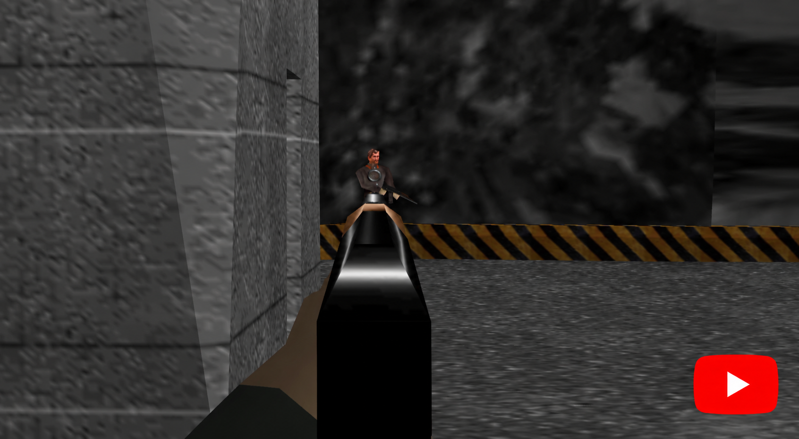

# Project Midas ADS

<!-- bright-builds-rules-readme-badges:begin -->

<!-- Managed upstream by bright-builds-rules. If this badge block needs a fix, open an upstream PR or issue instead of editing the downstream managed block. Keep repo-local README content outside this managed badge block. -->

[](https://github.com/pRizz/Project-Midas-ADS)
[](./LICENSE)
[](https://github.com/bright-builds-llc/bright-builds-rules)
[](https://openlinks.us/)

<!-- bright-builds-rules-readme-badges:end -->

Project Midas ADS is an independent fork of [Project Midas](https://github.com/murkantor/Project-Midas), adding modern aiming, movement, and HUD options to the GE PC port. This fork is maintained separately from upstream.

**[See the full list of changes from upstream →](FORK_CHANGES.md)** — the maintained inventory of this fork's additions, modifications, settings, and fixes.

## Download and play on Windows

**[DOWNLOAD HERE — latest Windows ZIP](https://github.com/pRizz/Project-Midas-ADS/releases/latest/download/Project-Midas-ADS-windows-x86.zip)** · [Release details and provenance](https://github.com/pRizz/Project-Midas-ADS/releases/latest) · [Build status](https://github.com/pRizz/Project-Midas-ADS/actions/workflows/windows-release.yml)

1. Download **Project-Midas-ADS-windows-x86.zip** and **extract the entire ZIP** into a writable folder, such as Documents. Keep `SDL2.dll` beside the executable. GitHub's “Source code” archives are for building, not playing.
2. Put your own **unmodified GoldenEye 007 USA ROM** (`.z64`, `.v64`, or `.n64`) in the extracted **Data** folder. Extract zipped ROMs first. No ROM is included or downloaded by the game.
3. Double-click **ProjectMidas.exe**. On first launch, the game prepares weapon icons from your ROM and caches them locally. No Python, compiler, administrator access or asset downloads are required. You can skip preparation with Esc; the game uses weapon names if icons are unavailable.

Windows 10/11, an x86-compatible CPU and an OpenGL 3.3-capable graphics driver are required. The 32-bit build also runs on 64-bit Windows. These are continuously published development builds from successful pushes to `main`.

For the embedded build time, commit and clickable source/build/release links, open **Options > Gameplay > Port Options > About Project Midas ADS**; the watch has the same entry. Windows links are blue and underlined and open in your default browser. Local or modified builds are labeled accordingly. The release page supplies signed provenance, hashes and build-input details; see [verification and maintainer instructions](scripts/port/releases.md).

To update, replace the supplied program files while keeping **Data** and **midas.ini**. Normal campaign saves and profiles are separate from executable-specific suspend points.

## Watch the latest gameplay demo

[](https://youtu.be/dI-G7Lo12hA)

**[Watch on YouTube: ADS Update — Hands, Better Sights & Sniper Scope Zoom (60 FPS)](https://youtu.be/dI-G7Lo12hA)**

## What's different in this fork?

- **Aim down sights (ADS):** right-click ADS by default, individual sight alignment for 20 supported firearms, and half-speed movement while aiming. Added hands and forearms support guns that originally lacked them. Rifle ADS arms, native pistol forearms and the karate-chop arm match the mission's watch-arm wardrobe with original fabric/skin textures and rolled or long sleeves. Unarmed HUD icons match that outfit too. The original red reticle mode remains selectable.
- **Sniper scope and wheel zoom:** aim through a centered scope, turn the whole view with the mouse, and adjust magnification with the mouse wheel.
- **Shift to sprint:** hold Left Shift to sprint; a gameplay setting can restore the original slow-walk behavior.
- **Sharper sights and combat feedback:** smooth reticles, optional hit markers, and directional damage indicators.
- **Enhanced fonts:** smooth, high-resolution community fonts for menus and HUD text, enabled by default in **Display > Video > Enhanced Fonts**. [Details and credits](scripts/port/enhanced_fonts.md).
- **Objective notifications:** named alerts show when mission objectives are completed or failed.
- **Weapon inventory HUD:** a compact strip highlights your selected weapon, supports text or rendered model icons, and fades while idle.
- **Always-visible health and armor:** persistent gauges become thinner and dimmer between hits; the original temporary display is also available.
- **Suspend points:** four manual slots, quicksave/quickload, and undo-load for solo missions.

See [Playing](#playing) below for controls and settings.

The underlying port is a work in progress built from the N64 decompilation. It runs on Windows and Linux and reads its game data from your own copy of the US cart.

## AI Disclaimer

Claude was used in the making of this project. If you don't agree with this, please do not download either the executables or the source.

## Playing

1. Put your GE (USA) cart image in the `Data` folder next to the executable. See `Data/README.txt` for the accepted formats and other ways to point the game at it.
2. Run `ProjectMidas.exe` (Windows) or `ProjectMidas` (Linux).

Files next to the executable:

| Path | What it is |
| --- | --- |
| `midas.ini` | Settings. Written on first run; delete it to restore the defaults. See `midas_ini_help.txt`. |
| `Data/` | Your cart image goes here. |
| `Data/Saves/eeprom.bin` | Save file. |
| `Data/SaveStates/` | Solo suspend points, quicksave, and undo-load, separated by campaign folder. |
| `Data/Profiles/` | Player profiles (`.geprofile`) and lifetime multiplayer stats (`.gestats`). |
| `Data/WeaponSets/` | Custom multiplayer weapon sets (`.gewset`). |
| `Data/MatchSettings/` | Saved multiplayer settings (`.gemp`), from Load / Save Settings. |
| `Data/Devices/` | Per-device settings (`.gedevice`). Keyboard and mouse binds are in `kbm.gedevice`. |
| `gamecontrollerdb.txt` | SDL controller mappings. |
| `gamecontrollerdefault.txt` | Built-in controller layouts. |
| `gamecontrolleruser.txt` | Your saved controller layouts. |
| `Data/Logs/ge_direct.log` | The run log on Windows (the game opens no console window). |
| `Data/Logs/crash.log` | Written if the game crashes. |
| `Mods/` | Reserved for modded carts. This build loads the stock cart only. |

An older `ge.ini` is renamed to `midas.ini` automatically on first run.

**Mouse Right** aims down the sights by default. Change **Gameplay > General
Settings > Aim Mode** to **Red Reticle** for the original aiming mode. The
existing **Aim Control** setting selects hold or toggle for either mode.
**Mouse Middle** remains a separate hold-to-ADS binding, configurable in the
controls menu, including for controllers.
You can walk and strafe at half speed while aiming down sights.
ADS adds basic low-poly hands and forearms to the 13 firearms that lack them,
including the KF7 Soviet. Pistols retain their original hands.
Each firearm's ADS pose has a slight upward angle to reveal its front sight
and give a view along the top of the gun.
Sniper ADS raises the rifle into a zoomed scope view with the gun and hands hidden
and a centered red crosshair. Mouse movement turns the view while scoped;
the existing zoom controls still adjust magnification.
While ADS with the sniper rifle, **Mouse Wheel Up/Down** zooms in/out instead
of switching weapons. Outside sniper ADS, the wheel uses its normal bindings.

Aiming reticles, the sniper crosshair, the optional always-on crosshair,
and the menu/watch target cursor use thin, smoothed lines and circles.
Custom crosshair colors still apply. Directional damage indicators use smooth curves.

Hold **Left Shift** while moving to sprint at 1.5 times normal speed.
**Gameplay > General Settings > Sprint** is on by default; turn it off to
restore Shift-to-walk at half speed. The **Walk / Sprint** control can be rebound.
Aiming and crouching prevent the sprint boost; ADS keeps its half-speed movement.

**Gameplay > HUD** includes four new options, all on by default:

- **Hit Markers:** thin, smoothed white lines confirm damage to a character; headshots use gold.
- **Damage Direction:** short red arcs point toward incoming damage and follow your view as you turn.
- **Objective Alerts:** queued notifications show the objective name and its updated status. Turn this off for the original messages.
- **Mission Timer:** enable this to show elapsed mission time with hundredths at the bottom left. On a mission/difficulty with a timed cheat unlock, its target appears beside your time (`00:42:50 / CHEAT 02:40`). The target is green while within time, amber with ten seconds remaining, and red once exceeded. Uses the same mission clock and whole-second deadline as the unlock check; pauses and suspend restores follow that clock. A saved best time for this mission and difficulty appears below as `BEST 02:03`; it is omitted if no record exists or in 007 mode. The campaign format stores whole seconds and caps records at 17:03, shown as `17:03+`. Difficulties without a cheat target still show elapsed time and any best record. Defaults to Off (`[display] mission_timer=1` enables it). Objectives and normal cheat-unlock eligibility still apply.
- **Weapon Strip:** a compact list near the bottom, above the ammo counters, highlights your equipped weapon. Cards, icons and text are scaled down by 30%. Larger inventories scroll with selection; `+N` shows how many weapons are outside the visible strip. After three seconds without switching weapons, the strip smoothly fades to 20% opacity; switching weapons brings it back.

**Weapon Strip Style** switches between **Text** (the default) and **Icons**. Icon mode shows full-colour, static renders of the actual weapon models, including silenced guns, rifles, launchers, and explosives; the selected weapon stays highlighted. Its name appears underneath the selected icon, then fades out completely after three seconds without switching weapons (over a one-second transition). Set `[display] weapon_hud_icons=1` in `midas.ini` to select icons directly. Windows prepares these images from your ROM on first launch and reuses a per-user cache; no rebuild or external tools are needed. If preparation is skipped or unavailable, icon mode falls back to weapon names. See [the icon generation guide](scripts/port/weapon_icons.md) for cache details and optional developer exports.

**Health Display** defaults to **Always**, keeping slimmer health and armor arcs visible during gameplay. Damage or a health/armor change restores full opacity at 75% of the original thickness; after three quiet seconds, they smoothly fade to 25% opacity and 20% thickness. Select **Automatic** for the original temporary gauges, or set `[display] always_health=0` in `midas.ini`.

These displays hide during menus, cutscenes, and death. Each setting can be changed independently.

### Mission cheat hints

The mission grid shows the highlighted mission's cheat status, required difficulty,
and target time. On the difficulty screen, a **Cheat target** badge marks the row
that can unlock it. **Cheat unlocked** (green) means the selected campaign save
has earned it; **Cheat to unlock** (amber) means it is still to be earned. Blue
**Cheat available - Unlock All** distinguishes temporary availability through
that setting. The footer also identifies a required difficulty that is still
locked. Completion checkmarks retain their original meaning; 007 has no timed
cheat target. These hints are always shown and do not require the HUD timer.

### Suspend points

Press **F6** or open **Watch > Gameplay > Suspend Points** for four manual slots,
a separate quicksave, and undo-load. Use arrows to choose a slot and Save/Load,
then Enter to accept. Saving over an occupied manual slot asks for a second
confirmation. Escape closes the menu. A controller can use its Move stick or
D-pad, Use/Menu Accept, and Menu Back; the actions can be rebound in Controls.

- **F5:** quicksave, replacing the previous quicksave.
- **F9:** quickload.
- **F8:** undo the last load and return to the mission state immediately before it.

Loads return directly to gameplay. A small toast identifies the loaded slot
and mission; saves and quicksaves show matching confirmations. Notifications
last three seconds, fading over the last half-second. You can load after dying
or from the title screen using the same campaign folder. Saving is
limited to solo gameplay while Bond is alive, or the fully opened watch menu.
Campaign progress and settings are not rolled back.

**First-version compatibility:** keep the same executable and ROM. A rebuild or
different executable makes existing suspend points incompatible; the game
refuses those files. These are local game-state images, separate from ordinary
campaign saves. See [save-state details and validation](scripts/port/save_states.md).

## Building

The build runs in Docker, which has every tool and library both builds need. You also need the GE (USA) cart as `baserom.u.z64` in the repository root:

```
sha1: abe01e4aeb033b6c0836819f549c791b26cfde83
```

### On Windows: use WSL

The commands below are for a Linux shell. On Windows, run them in WSL:

1. Install WSL with Ubuntu (`wsl --install` in PowerShell), and turn on WSL integration in Docker Desktop (Settings > Resources > WSL integration).
2. Open the Ubuntu terminal and clone the repository inside WSL, not under `/mnt/c` (much faster):
   ```
   cd ~
   git clone https://github.com/pRizz/Project-Midas.git
   cd Project-Midas
   ```
3. Copy your cart in, for example from your Windows Downloads folder:
   ```
   cp /mnt/c/Users/<you>/Downloads/baserom.u.z64 .
   ```

### Build steps

1. Build the image (once):
   ```
   docker build --network=host --build-arg HOST_UID=$(id -u) --build-arg HOST_GID=$(id -g) -t goldeneye .
   ```
2. Start a container in the repository:
   ```
   docker run --rm -it -v $(pwd):/home/dev/project goldeneye
   ```
3. Extract the assets (once):
   ```
   ./scripts/extract_baserom.u.sh
   make convert_props convert_chrs convert_guns combine_images
   ```
4. Build for Windows (x86):
   ```
   cmake -B build_win -DCMAKE_TOOLCHAIN_FILE=cmake/mingw-i686.cmake -DCMAKE_BUILD_TYPE=Debug -DGE_VIDEO=ON -DSDL2_MINGW_ROOT=$HOME/sdl2-mingw/SDL2-2.30.11/i686-w64-mingw32
   cmake --build build_win -j$(nproc)
   ```
5. Build for Linux:
   ```
   cmake -B build_pc -DCMAKE_BUILD_TYPE=Debug -DGE_VIDEO=ON -DSDL2_LINUX_ROOT=$HOME/sdl2-linux-i686
   cmake --build build_pc -j$(nproc)
   ```

| Build | Game | Next to it |
| --- | --- | --- |
| Windows | `build_win/ProjectMidas.exe` | `SDL2.dll`, the controller files, `Data/` |
| Linux | `build_pc/ProjectMidas` | the controller files, `Data/` |

To play, put a copy of `baserom.u.z64` in that build's `Data/` folder. On Windows, copy the whole `build_win` folder somewhere in Windows (from WSL: `explorer.exe build_win`) and run `ProjectMidas.exe` there. The Linux build needs 32-bit SDL2 and OpenGL on the machine that runs it. On Ubuntu or Debian:

```
sudo dpkg --add-architecture i386
sudo apt update
sudo apt install libsdl2-2.0-0:i386 libgl1:i386
```

## Known issues

- On some Linux systems, levels draw as a few large blank triangles. Starting the game with these environment variables works around it:
  ```
  GE_FULLHEIGHT=0 GE_EDGEINSET=1 ./ProjectMidas
  ```

## Contributing

Every repository change must update the [fork change inventory](FORK_CHANGES.md); see [AGENTS.md](AGENTS.md).

For hands, arms and weapon rendering, open the [visual review gallery](review/hand-gallery/index.html) locally in a browser. It compares PP7, AK47/KF7 and Klobb in regular/ADS poses across six wardrobes, plus all generated weapon icons. See [generation and pre-commit setup](scripts/port/hand_gallery.md).

For ADS changes and bug reports, use [this fork's issues](https://github.com/pRizz/Project-Midas/issues) and pull requests. The inherited [CONTRIBUTING.md](CONTRIBUTING.md) describes upstream contribution guidelines, including the rules for AI-assisted changes. General port development is coordinated in [upstream Project Midas](https://github.com/murkantor/Project-Midas).

## License

Project Midas ADS retains the upstream Project Midas port code's MIT license and attribution; see [LICENSE](LICENSE). The license does not cover the decompiled game code, GE itself or its assets. Bundled third-party code keeps its own license; see `tools/THIRD_PARTY_NOTICES.txt`.

## Acknowledgements

Project Midas ADS builds on [Project Midas](https://github.com/murkantor/Project-Midas) by murkantor and contributors, and the work of the people and projects credited below.

- [GoldenEye decompilation](https://github.com/n64decomp/007) by KholdFuzion and contributors
- [GoldenEye docs](https://github.com/kholdfuzion/goldeneye_docs)
- [Perfect Dark decompilation](https://github.com/n64decomp/perfect_dark) by Ryan Dwyer and contributors
- [Perfect Dark PC port](https://github.com/fgsfdsfgs/perfect_dark) by fgsfds
- [Perfect Dark netplay](https://github.com/murkantor/perfect_dark_netplay) (fork of fgsfds' `port-net`)
- [GE Plus](https://github.com/Joshua-1248/GoldenEye-007-Plus) by Joshua
- *The DOOM III Network Architecture* by J.M.P. van Waveren (id Software, 2006)
- Fast3D renderer by Emill and MaikelChan (MIT)
- [SDL2](https://github.com/libsdl-org/SDL) and [glad](https://github.com/Dav1dde/glad)
- [SDL_GameControllerDB](https://github.com/mdqinc/SDL_GameControllerDB)
- [ENet](https://github.com/lsalzman/enet)
- [xdelta3](https://github.com/jmacd/xdelta)
- [ido-static-recomp](https://github.com/decompals/ido-static-recomp), [rabbitizer](https://github.com/Decompollaboration/rabbitizer), [qemu-irix](https://github.com/n64decomp/qemu-irix) and [armips](https://github.com/Kingcom/armips)
- The 1964 emulator and its GE/Perfect Dark mouse injector
- [pj64raphnetraw](https://github.com/raphnet/pj64raphnetraw) by Raphael Assenat ([raphnet-tech](https://www.raphnet-tech.com)), the reference for the raphnet adapter protocol

GE is owned by Rare, Nintendo and the Bond rights holders. No ROM or extracted game assets are distributed. The review gallery contains rendered gameplay-model references; the underlying artwork belongs to its rights holders.
